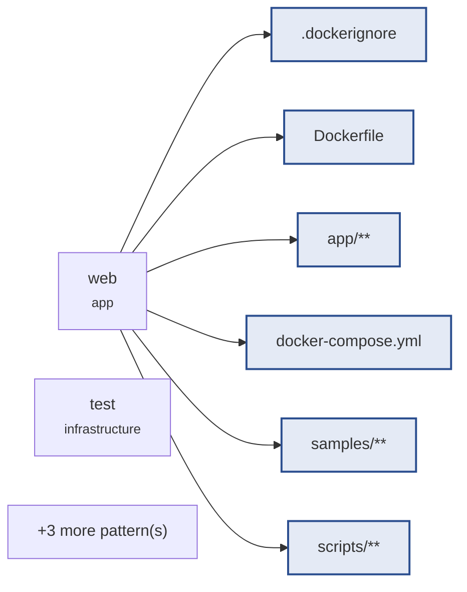

# mail-digest · daily-digest

> **Pending approval.** Implementation is blocked: no file is written
> until this brief is approved.
>
> ```
> circle brief approve daily-digest
> ```

`daily-digest` · 7 task(s) · 9 file pattern(s) · plan `b799dd11f5cf2f5b`

## Goal · what done means

- **Verified** — The web service answers GET /health with 200 on port 8080 and the test service runs the suite, both from one image through docker compose. — `test:integration`
- **Verified** — A directory of .eml files, including the shipped 9-12 samples over 3 consecutive days with a reply Thread, parses into Messages with sender, UTC date, subject and body, skipping any without a parseable date. — `test:unit`
- **Verified** — Given Messages, a Digest Day and an Owner, the Digest has the day's total, Senders ranked by count, Threads grouped by Normalised Subject with Needs Reply, and Action Items. — `test:unit`
- **Verified** — GET /api/digest and GET / return the Digest for today or ?date= from MAIL_DIR, with previous/next day links, escaped text, 400 on an invalid date and an empty Digest for a quiet day. — `test:integration`
- **Verified** — The Needs Reply flag is judged against the Owner given in OWNER_EMAIL, case-insensitively, and the old OWNER variable is no longer read. — `test:integration`
- **Verified** — Running docker compose up web serves the Digest of the sample Messages (MAIL_DIR set, samples in the image), so /api/digest?date=2025-03-11 has a total above zero. — `test:smoke`
- **Verified** — Image builds take HTTPS_PROXY and the CA bundle from compose with empty defaults: scripts/build_check.sh proves the build args are wired and the images build with and without them. — `test:build`

All 7 proven by a command. None closes on an assertion.

## Blast radius · what this touches



| Pattern | Task |
|---|---|
| `.dockerignore` | `daily-digest-1` |
| `Dockerfile` | `daily-digest-1`, `daily-digest-6`, `daily-digest-7` |
| `app/**` | `daily-digest-1`, `daily-digest-2`, `daily-digest-3`, `daily-digest-4`, `daily-digest-5` |
| `docker-compose.yml` | `daily-digest-1`, `daily-digest-6`, `daily-digest-7` |
| `samples/**` | `daily-digest-2` |
| `scripts/**` | `daily-digest-6`, `daily-digest-7` |
| `tests/**` | `daily-digest-1`, `daily-digest-5` |
| `tests/integration/**` | `daily-digest-4` |
| `tests/unit/**` | `daily-digest-2`, `daily-digest-3` |

## Plan · in readiness order

| # | Task | Proven by | Blocked on |
|---|---|---|---|
| `daily-digest-1` | Docker stack serving /health | `test:integration` (integration) | — |
| `daily-digest-5` | Owner read from OWNER_EMAIL | `test:integration` (integration) | — |
| `daily-digest-6` | web serves the sample Mailbox by default | `test:smoke` (e2e) | — |
| `daily-digest-2` | Sample mail and parsing into Messages | `test:unit` (unit) | `daily-digest-1` |
| `daily-digest-7` | Proxy and CA wiring for image builds | `test:build` (integration) | `daily-digest-6` |
| `daily-digest-3` | Digest for one Digest Day | `test:unit` (unit) | `daily-digest-2` |
| `daily-digest-4` | Serve the Digest as JSON and HTML | `test:integration` (integration) | `daily-digest-3` |

## Risks & unknowns

- **LOW** — No coverage floor is configured, so the status score cannot use coverage as evidence.
- **MEDIUM** — The radius includes docker-compose.yml — the execution contract's own substrate.

## Definitions consulted

- `.circle/items/daily-digest/shape.md`
- `.circle/items/daily-digest/spec.md`
- `app/DOMAIN.md`

---

_Generated by circle from `.circle/` state. Structure is derived, not written: every section above is a fact the repository already knows._
