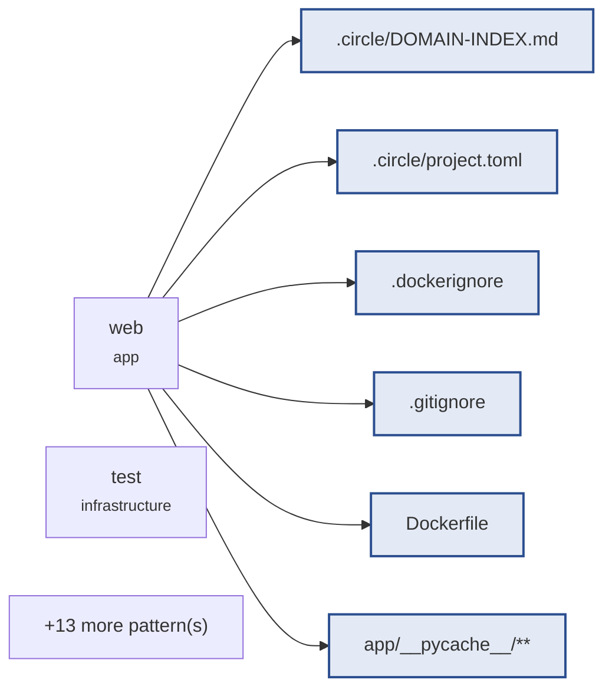

# mail-digest · hardening

> **Pending approval.** Implementation is blocked: no file is written
> until this brief is approved.
>
> ```
> circle brief approve hardening
> ```

`hardening` · 10 task(s) · 19 file pattern(s) · plan `8648990a44db77c6`

## Goal · what done means

- **Verified** — The test service runs the built image with OWNER_EMAIL forwarded (default owner@example.com) and no bind mounts, build_check.sh has no unused loop variable, and docs/STANDARDS.md is registered as standards knowledge. — `test:build`
- **Verified** — The Mailbox lower-cases Senders once, matches .EML/.PDF case-insensitively, reads HTML-only Messages, and counts every unreadable, undecodable or undated file as a Skipped File with only specific parse errors caught. — `test:unit`
- **Verified** — A PDF Email's unindented wrapped header value continues its header, a repeated header keeps its first value, and Action Item sentences are not split at decimals or common abbreviations. — `test:unit`
- **Verified** — The web interface speaks of day (with ?date= as alias), returns 400 for an empty, malformed or unpadded day, renders the first and last representable days without a link beyond them, and shows the sample Mailbox's Needs Reply for the default Owner. — `test:integration`
- **Verified** — The page carries a viewport meta tag, inline stylesheet, visible EML/PDF badge and 'No mail on this day' for a quiet day, request errors are logged, and the by-eye readability is left to the reviewer. — `test:integration`
- **Verified** — The committed app/__pycache__/*.pyc files are removed from git and a root .gitignore keeps bytecode, caches and machine-local files out. — `test:build`
- **Verified** — The web service forwards OWNER_EMAIL with the default owner@example.com exactly as test does, proved by a check build_check.sh runs. — `test:build`
- **Verified** — build_digest itself returns the Digest Day under the key day, with its unit tests updated, and server.py no longer renames it. — `test:unit`
- **Verified** — A PDF Email header value that wraps onto an unindented line after the last header line continues that header instead of spilling into the body. — `test:unit`
- **Verified** — In a PDF Email, an unindented line that is not a header continues the last header while the body has not started (no blank line yet), and an unparseable Date no longer absorbs a following header or body line. — `test:unit`

All 10 proven by a command. None closes on an assertion.

## Blast radius · what this touches



| Pattern | Task |
|---|---|
| `.circle/DOMAIN-INDEX.md` | `hardening-6fad8297` |
| `.circle/project.toml` | `hardening-6fad8297` |
| `.dockerignore` | `hardening-6fad8297` |
| `.gitignore` | `hardening-cd117ef7` |
| `Dockerfile` | `hardening-6fad8297` |
| `app/__pycache__/**` | `hardening-cd117ef7` |
| `app/digest.py` | `hardening-e475d7a9`, `hardening-39b323da`, `hardening-73abf600` |
| `app/mailbox.py` | `hardening-1fc920fe`, `hardening-e475d7a9`, `hardening-32d4b937`, `hardening-4cd9b245` |
| `app/server.py` | `hardening-39b323da`, `hardening-0e93c40f`, `hardening-73abf600` |
| `docker-compose.yml` | `hardening-6fad8297`, `hardening-66103364` |
| `docs/STANDARDS.md` | `hardening-6fad8297` |
| `samples/**` | `hardening-1fc920fe` |
| `scripts/**` | `hardening-6fad8297` |
| `scripts/build_check.sh` | `hardening-cd117ef7`, `hardening-66103364` |
| `tests/integration/**` | `hardening-39b323da`, `hardening-0e93c40f` |
| `tests/support/**` | `hardening-1fc920fe`, `hardening-e475d7a9`, `hardening-39b323da` |
| `tests/unit/**` | `hardening-1fc920fe`, `hardening-e475d7a9` |
| `tests/unit/test_digest.py` | `hardening-73abf600` |
| `tests/unit/test_mailbox_pdf.py` | `hardening-32d4b937`, `hardening-4cd9b245` |

## Plan · in readiness order

| # | Task | Proven by | Blocked on |
|---|---|---|---|
| `hardening-32d4b937` | hardening-9 A wrapped last header stays in its header | `test:unit` (unit) | — |
| `hardening-4cd9b245` | hardening-10 The blank line ends the Header Block | `test:unit` (unit) | — |
| `hardening-6fad8297` | hardening-1 Gates prove the built image | `test:build` (integration) | — |
| `hardening-73abf600` | hardening-8 build_digest returns the day key | `test:unit` (unit) | — |
| `hardening-cd117ef7` | hardening-6 Bytecode is not committed | `test:build` (integration) | — |
| `hardening-1fc920fe` | hardening-2 Unreadable email files are Skipped Files | `test:unit` (unit) | `hardening-6fad8297` |
| `hardening-66103364` | hardening-7 The web service forwards the Owner | `test:build` (integration) | `hardening-cd117ef7` |
| `hardening-e475d7a9` | hardening-3 Wrapped headers and whole Action Items | `test:unit` (unit) | `hardening-6fad8297` |
| `hardening-39b323da` | hardening-4 The Digest Day is a strict day | `test:integration` (integration) | `hardening-1fc920fe` |
| `hardening-0e93c40f` | hardening-5 The page is readable and errors are logged | `test:integration` (integration) | `hardening-39b323da` |

## Risks & unknowns

- **LOW** — No coverage floor is configured, so the status score cannot use coverage as evidence.
- **MEDIUM** — The radius includes docker-compose.yml — the execution contract's own substrate.

## Definitions consulted

- `.circle/items/hardening/shape.md`
- `.circle/items/hardening/spec.md`
- `app/DOMAIN.md`

---

_Generated by circle from `.circle/` state. Structure is derived, not written: every section above is a fact the repository already knows._
