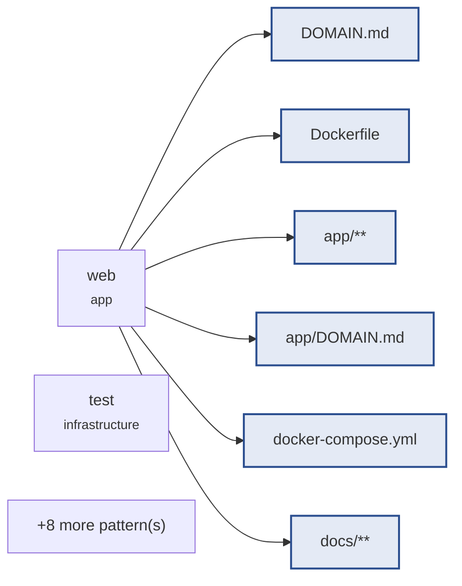

# mail-digest · pdf-ingest

> **Pending approval.** Implementation is blocked: no file is written
> until this brief is approved.
>
> ```
> circle brief approve pdf-ingest
> ```

`pdf-ingest` · 7 task(s) · 14 file pattern(s) · plan `885f6b9d7069425b`

## Goal · what done means

- **Verified** — The image builds on a normal machine and behind the proxy, with pinned pypdf and reportlab importable in the test service and no machine-specific value committed. — `test:image`
- **Verified** — A directory of real .eml and .pdf files loads into Messages with Source and a Skipped File count, and the Digest treats PDF Messages exactly like .eml ones, malformed, encrypted and header-less PDFs being skipped without raising. — `test:unit`
- **Verified** — GET /api/digest shows source on each Message and the skipped count, and GET / shows an escaped PDF/EML badge and a skipped line only when above zero. — `test:integration`
- **Verified** — Three committed sample PDF Emails, one a reply in an existing Thread, are reproduced byte for byte by a committed script and give the expected Digest totals on each of the three days. — `test:unit`
- **Verified** — The HTTP seam test for 2025-03-10 expects the Digest total that includes the sample PDF Email (5). — `test:integration`
- **Verified** — scripts/build_check.sh proves the compose wiring with empty defaults and builds the image with whatever CA_BUNDLE_DIR the machine provides, naming no machine path. — `test:build`
- **Verified** — reportlab, the test-only PDF writer, is pinned in requirements-test.txt and installed only in the test image, so the web image ships pypdf alone. — `test:image`

All 7 proven by a command. None closes on an assertion.

## Blast radius · what this touches



| Pattern | Task |
|---|---|
| `DOMAIN.md` | `pdf-ingest-d7ab5833` |
| `Dockerfile` | `pdf-ingest-a54c5832`, `pdf-ingest-5212dcc7` |
| `app/**` | `pdf-ingest-d7ab5833`, `pdf-ingest-b489369a` |
| `app/DOMAIN.md` | `pdf-ingest-d7ab5833` |
| `docker-compose.yml` | `pdf-ingest-a54c5832`, `pdf-ingest-5212dcc7` |
| `docs/**` | `pdf-ingest-a54c5832` |
| `requirements*.txt` | `pdf-ingest-a54c5832` |
| `requirements-test.txt` | `pdf-ingest-5212dcc7` |
| `requirements.txt` | `pdf-ingest-5212dcc7` |
| `samples/**` | `pdf-ingest-30aecdfb` |
| `scripts/**` | `pdf-ingest-30aecdfb`, `pdf-ingest-152b7cf4` |
| `tests/integration/**` | `pdf-ingest-b489369a`, `pdf-ingest-931f30a5` |
| `tests/support/**` | `pdf-ingest-d7ab5833`, `pdf-ingest-b489369a`, `pdf-ingest-30aecdfb` |
| `tests/unit/**` | `pdf-ingest-d7ab5833`, `pdf-ingest-30aecdfb` |

## Plan · in readiness order

| # | Task | Proven by | Blocked on |
|---|---|---|---|
| `pdf-ingest-152b7cf4` | pdf-ingest-6: build check proves proxy wiring and builds with the machine's own CA_BUNDLE_DIR | `test:build` (integration) | — |
| `pdf-ingest-5212dcc7` | web image installs only requirements.txt, test image also installs requirements-test.txt | `test:image` (integration) | — |
| `pdf-ingest-931f30a5` | pdf-ingest-5: integration test counts the sample PDFs in the 2025-03-10 total | `test:integration` (integration) | — |
| `pdf-ingest-a54c5832` | pdf-ingest-1: image installs pypdf and reportlab, portable behind the proxy | `test:image` (integration) | — |
| `pdf-ingest-d7ab5833` | pdf-ingest-2: a PDF Email in the Mailbox becomes a Message with a Source | `test:unit` (unit) | `pdf-ingest-a54c5832` |
| `pdf-ingest-30aecdfb` | pdf-ingest-4: reproducible sample PDF Emails on the three sample days | `test:unit` (unit) | `pdf-ingest-d7ab5833` |
| `pdf-ingest-b489369a` | pdf-ingest-3: Source and Skipped Files in /api/digest and on the page | `test:integration` (integration) | `pdf-ingest-d7ab5833` |

## Risks & unknowns

- **LOW** — No coverage floor is configured, so the status score cannot use coverage as evidence.
- **MEDIUM** — The radius includes docker-compose.yml — the execution contract's own substrate.

## Definitions consulted

- `.circle/items/pdf-ingest/shape.md`
- `.circle/items/pdf-ingest/spec.md`
- `app/DOMAIN.md`

---

_Generated by circle from `.circle/` state. Structure is derived, not written: every section above is a fact the repository already knows._
