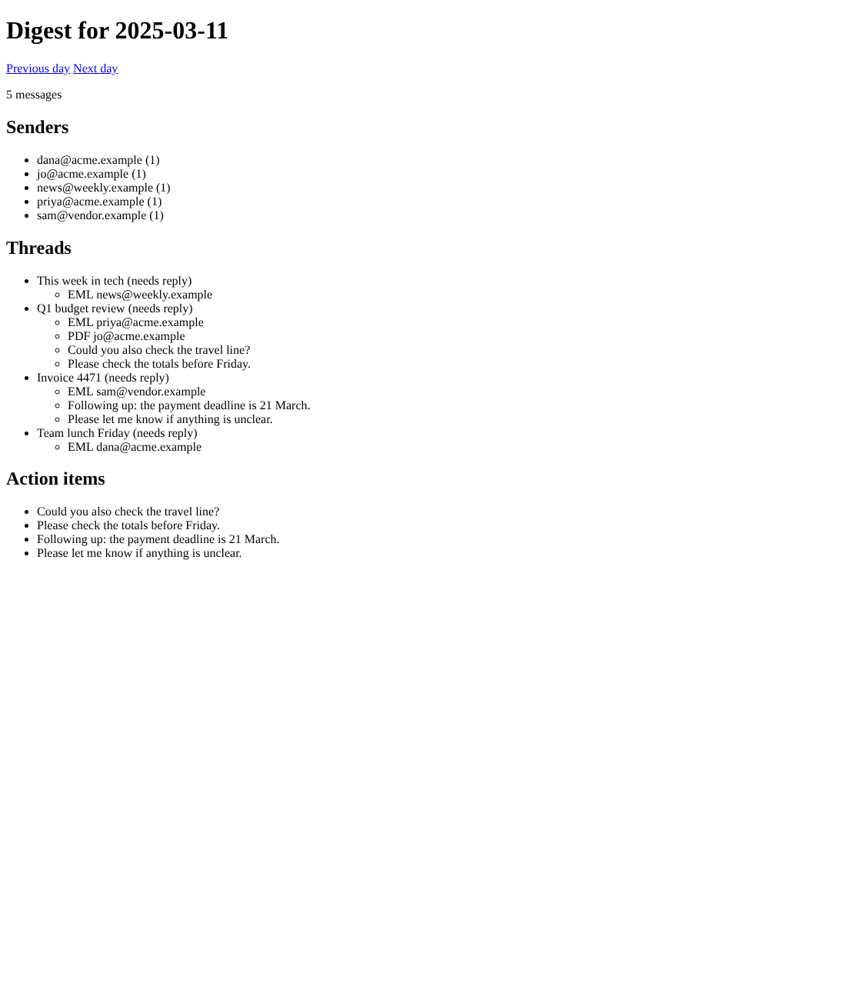

# Mail Digest — built with Circle

A small web app that reads a mailbox — `.eml` files and emails exported as PDF —
and shows a **daily summary**: how much arrived, from whom, which threads moved,
which need a reply, and the sentences that ask you for something.



It was built end to end by Claude Code agents running under Circle, as a dogfood
of the framework. The process is the point of this example, and all of it is
here: the shapes, specs, plans, approvals and reviews under `.circle/items/`, the
domain model in `app/DOMAIN.md` and `.circle/DOMAIN-INDEX.md`, and the commit
history in `docs/HISTORY.txt`. What the agents found wrong with Circle along the
way, and what was fixed, is iteration 7 of
[`trials/FINDINGS.md`](../../trials/FINDINGS.md).

## Run it

```bash
docker compose up -d --build web
open http://localhost:8080/?date=2025-03-11     # the samples cover 10–12 March 2025
curl 'http://localhost:8080/api/digest?date=2025-03-11'
docker compose down
```

Point it at your own mail with `MAIL_DIR` (a directory of `.eml` and `.pdf` files)
and say whose mailbox it is with `OWNER_EMAIL`, so "needs reply" means you.

Behind a TLS-intercepting proxy, see `docs/DEV-ENVIRONMENT.md`.

## How it was built

Two items, run in parallel, each through the whole Circle lifecycle:

| Item | Shaped → planned | Built | Review rounds | Tasks |
|---|---|---|---|---|
| `daily-digest` — read `.eml`, build the daily Digest, serve HTML + JSON | one headless session, resumed through shape → spec → tasks | one fresh session per task, in its own worktree | 2 — the first found the Owner read from the wrong variable and a container serving an empty mailbox | 7 (4 planned + 3 from review) |
| `pdf-ingest` — read emails delivered as PDF | on `main`, **while** `daily-digest` was being built | two tasks concurrently in two task worktrees | 2 — merge regressions, then a test-only dependency in the production image | 7 (4 planned + 3 from merge and review) |

Every approval was given by the operator after reading the brief; every change
to the plan made the approval stale and needed a new one. Gates run through
Docker (`test:unit`, `test:integration`, `test:smoke`, `test:image`,
`test:build`), so they prove the container, not the host.

28 headless sessions, 261 turns, about $7 of model usage.
